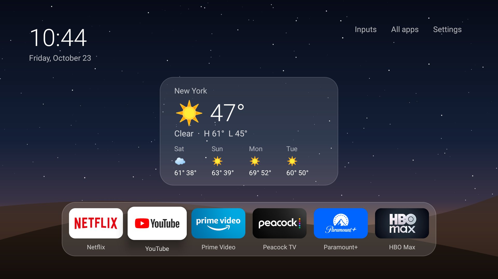
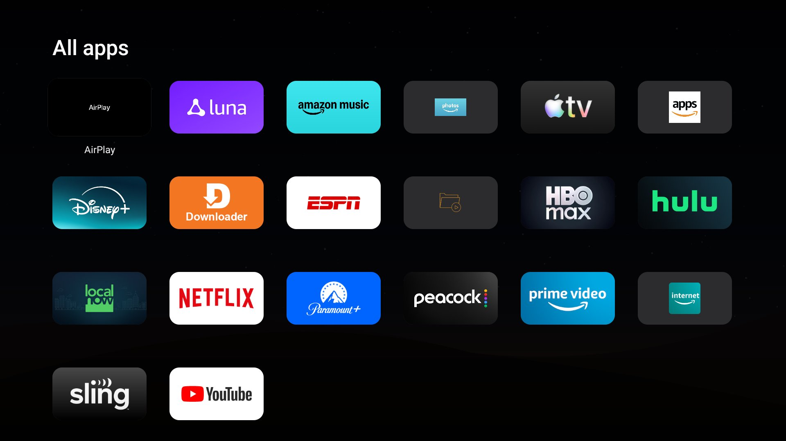
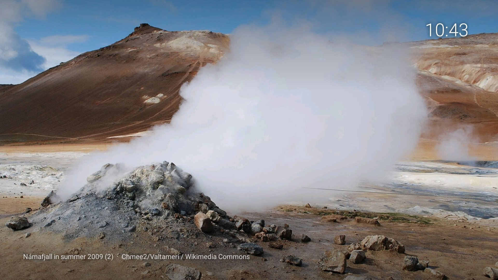

# Slate

**A minimal, Apple TV–style home screen for Google TV and Fire TV. No ads, no tracking, no recommendations.**

Slate replaces the ad-filled stock launcher with a quiet home screen: a clock, a weather card, and a frosted-glass dock of the apps you actually use. When idle it becomes an ambient screensaver of wild landscapes. It's one small Kotlin app with no dependencies, no account, and no analytics.



| All apps | Ambient screensaver |
|---|---|
|  |  |

## Features

- **Glass dock.** Your favourite apps, in the order you choose. Long-press any app (in the dock or in *All apps*) to pin or unpin it.
- **All apps.** A clean grid of app banners; the name appears when an app is selected, as on tvOS.
- **Weather card.** Current conditions and a 4-day forecast from [Open-Meteo](https://open-meteo.com). No API key, and the only thing sent is a fixed location you configure.
- **Ambient screensaver.** Featured photographs of mountains, lakes, waterfalls, volcanoes and coasts from [Wikimedia Commons](https://commons.wikimedia.org/wiki/Commons:Featured_pictures), with a slow Ken Burns zoom, crossfades, a clock, and the photographer credited on screen.
- **Inputs.** On TVs with HDMI inputs (Fire TV Edition sets), an *Inputs* link lets you switch sources.
- **Custom wallpaper.** Push any photo to the device, or keep the built-in night sky.
- **Tiny.** No libraries: plain Android views, about 500 lines of Kotlin.

## Requirements

- Android TV / Google TV (tested on an onn 4K, Android 14), or
- Fire TV running Fire OS 7 or 8 (tested on a Fire TV Edition smart TV, Fire OS 7.7). Newer Fire TV devices that run **Vega OS** cannot sideload apps.
- A computer with [`adb`](https://developer.android.com/tools/releases/platform-tools) on the same network.

## Build

```sh
git clone https://github.com/doktorigi/slate-launcher
cd slate-launcher
./gradlew assembleDebug        # → app/build/outputs/apk/debug/app-debug.apk
```

Set your weather location in `local.properties` (it's git-ignored). Without it, Slate defaults to New York:

```properties
weather.place=Springfield
weather.lat=39.7817
weather.lon=-89.6501
```

## Install on Google TV / Android TV

1. On the TV, go to **Settings → System → About** and press **Android TV OS build** seven times. Then go to **Developer options** and turn on **Wireless debugging**.
2. Pair and install:
   ```sh
   adb pair <tv-ip>:<pairing-port> <code>
   adb connect <tv-ip>:<port>
   adb install app-debug.apk
   adb shell cmd package set-home-activity com.doktorigi.slate/.MainActivity
   ```
3. Optional: make Slate the screensaver:
   ```sh
   adb shell settings put secure screensaver_components com.doktorigi.slate/.AmbientDream
   adb shell settings put secure screensaver_enabled 1
   ```
4. Optional: disable the stock launcher so its ads stop loading in the background. **Set Slate as home first**, then disable both packages:
   ```sh
   adb shell pm disable-user --user 0 com.google.android.apps.tv.launcherx
   adb shell pm disable-user --user 0 com.google.android.tungsten.setupwraith   # otherwise it re-enables the launcher
   ```
   Disabling the stock launcher also breaks Chromecast casting on Google TV.

## Install on Fire TV

Fire OS always sends the Home button to Amazon's launcher and won't let you disable it. Slate works around this with a small accessibility service that brings Slate up whenever Amazon's home screen appears.

1. On the TV, go to **Settings → My Fire TV → About** and press the device name seven times. Then go to **Developer options** and turn on **ADB debugging**.
2. Install and enable the Home redirect:
   ```sh
   adb connect <tv-ip>:5555
   adb install app-debug.apk
   adb shell settings put secure enabled_accessibility_services com.doktorigi.slate/.HomeGuard
   adb shell settings put secure accessibility_enabled 1
   ```

On Fire TV:
- **Home shows Amazon's screen for about 4 seconds** before Slate replaces it. Android blocks app switches for 5 seconds after Home, and only system-signed apps are exempt.
- **Fire OS only runs Amazon's own screensavers**, so Slate starts its landscape slideshow itself after 5 minutes idle on the home screen. To stop Amazon's ambient screensaver, which shows ads, from taking over first:
  ```sh
  adb shell pm disable-user --user 0 com.amazon.tv.ftvambient
  adb shell pm disable-user --user 0 com.amazon.ftv.screensaver
  ```
- After reinstalling Slate, toggle `accessibility_enabled` to `0` and back to `1`. Fire OS otherwise keeps a stale copy of the service.

## Privacy cleanup (optional)

These are the packages that were disabled on the test devices. Everything is done with `pm disable-user`, which is reversible: undo it with `adb shell pm enable <package>`. Disable a few at a time and check that your remote, inputs and apps still work.

<details>
<summary>Google TV (onn 4K)</summary>

| Package | What it is |
|---|---|
| `com.android.adservices.api` | Android ad services / Privacy Sandbox |
| `com.android.ondevicepersonalization.services` | On-device ad personalization |
| `com.android.federatedcompute.services` | Federated learning |
| `com.google.android.feedback`, `com.android.tv.feedbackconsent` | Feedback and diagnostics |
| `com.google.android.apps.tv.dreamx` | Google ambient mode (with recommendations) |
| `com.google.android.katniss` | Assistant voice search (disables the mic button) |
| `com.google.android.apps.mediashell` | Chromecast receiver (disables casting) |
| `com.google.android.partnersetup` | Partner app installs |
</details>

<details>
<summary>Fire TV</summary>

| Package | What it is |
|---|---|
| `com.amazon.tv.acr` | Automatic content recognition (identifies what's on screen, including HDMI) |
| `com.amazon.hybridadidservice` | Advertising ID |
| `com.amazon.kso.blackbird` | Sponsored content / ads |
| `com.amazon.shoptv.client`, `com.amazon.shoptv.firetv.client` | Shopping |
| `com.amazon.sneakpeek` | Autoplaying previews |
| `com.amazon.tv.fw.metrics`, `com.amazon.wirelessmetrics.service` | Metrics |
| `com.amazon.tv.democontent.provider` | Demo content |

Amazon protects some packages, so they can't be disabled, for example `com.amazon.device.metrics` and `com.amazon.ftvads.deeplinking`. Also turn off **Settings → Preferences → Privacy Settings → Device Usage Data / Collect App Usage Data / Interest-based Ads**.
</details>

## Custom wallpaper

```sh
adb push photo.jpg /sdcard/Android/data/com.doktorigi.slate/files/wallpaper.jpg
```

## Adding widgets

The middle of the home screen is a plain `FrameLayout` (`MainActivity.widgets`). `WeatherWidget.kt` shows the pattern: a self-contained view with a `refresh()` called from `onResume`.

## Revert to stock

```sh
adb shell pm enable com.google.android.apps.tv.launcherx              # Google TV
adb shell pm enable com.google.android.tungsten.setupwraith
adb shell settings put secure enabled_accessibility_services ""       # Fire TV
adb uninstall com.doktorigi.slate
```

## Credits

- Weather: [Open-Meteo](https://open-meteo.com) (CC BY 4.0)
- Screensaver photos: [Wikimedia Commons featured pictures](https://commons.wikimedia.org/wiki/Commons:Featured_pictures); each photographer is credited on screen
- Design inspired by tvOS and Lukas Margerie's [*I Gave Claude Code Control of My TV*](https://www.youtube.com/watch?v=i0ytu6k8uac)

## License

[MIT](LICENSE)
